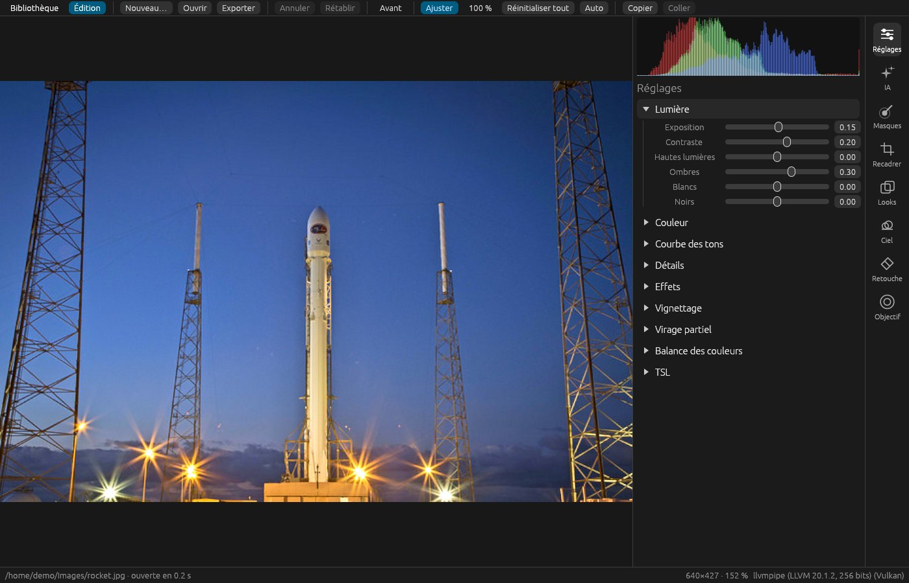
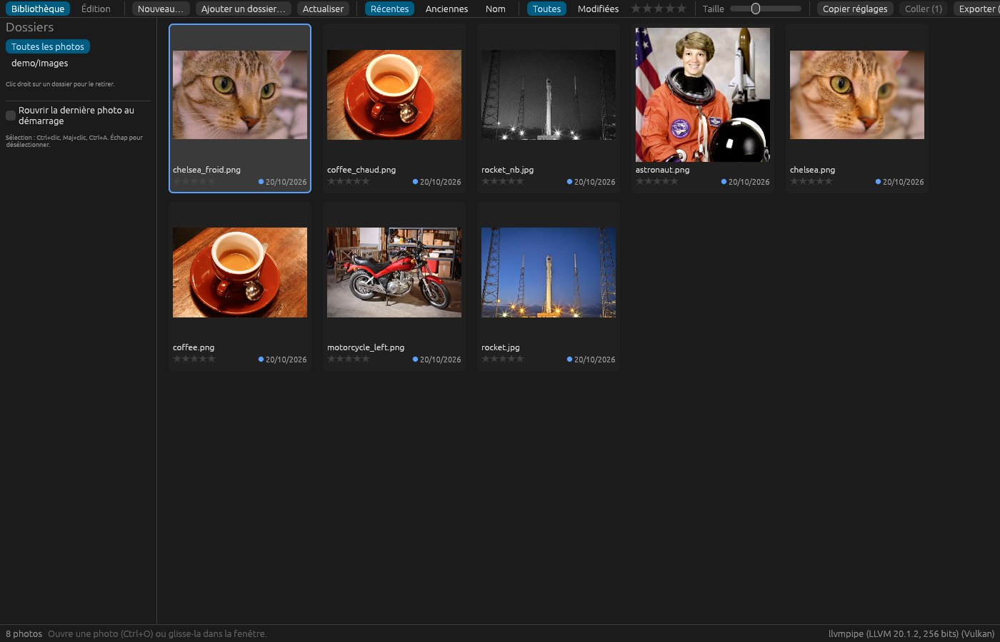
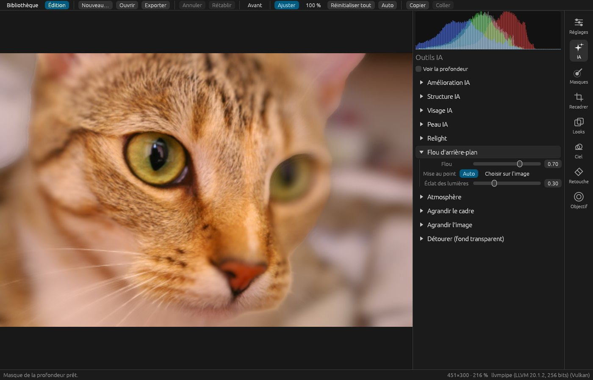
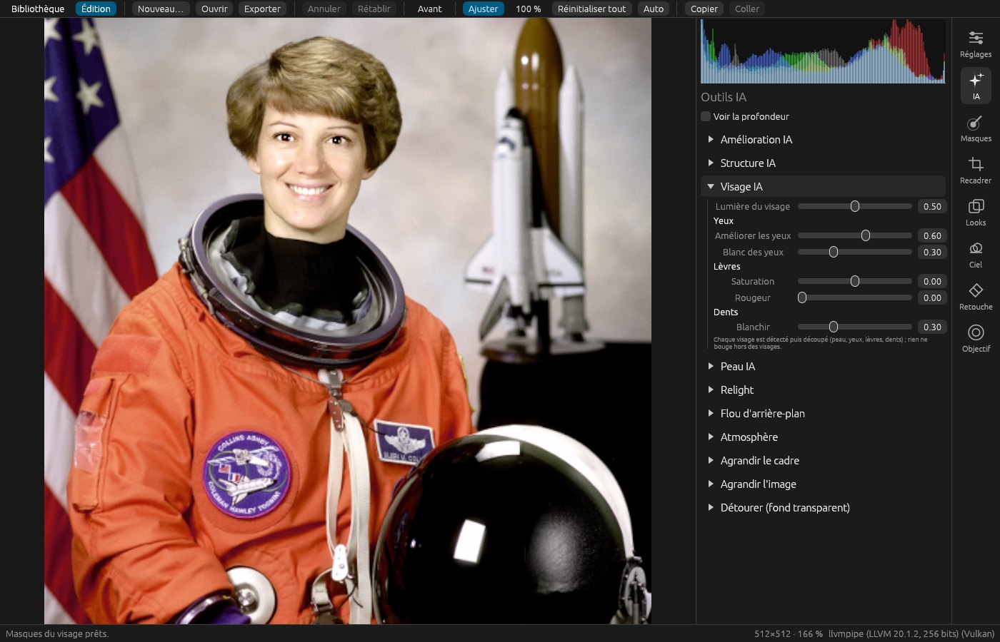
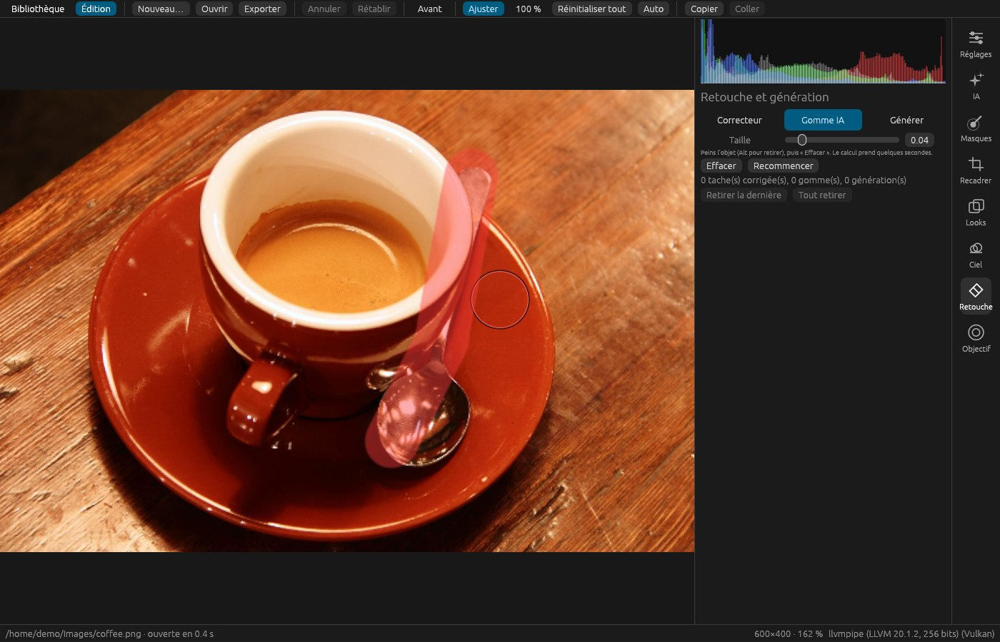

# Luminux IA

Éditeur photo pour Linux inspiré de Luminar Neo. Les réglages sont non destructifs et le rendu se fait sur
le GPU (Vulkan). La plupart des outils IA tournent en local ; génération et agrandissement passent par un serveur ComfyUI ou par le moteur local intégré (stable-diffusion.cpp).

## Installer

1. Télécharge `Luminux_IA-x86_64.AppImage` dans les [Releases](../../releases).
2. Lance-la :

       chmod +x Luminux_IA-x86_64.AppImage
       ./Luminux_IA-x86_64.AppImage

Il suffit d'une carte graphique compatible Vulkan, qu'elle soit AMD, NVIDIA ou Intel. Rien ne dépend de
CUDA. Les modèles IA se téléchargent tout seuls la première fois qu'un outil en a besoin.

## Ce qu'il sait faire

| | |
|---|---|
| **Bibliothèque** | Dossiers, vignettes, notes, filtres, copier/coller des réglages, export par lots. |
| **Réglages** | Lumière, couleur, courbes, TSL, détails, effets, vignettage, virage partiel, balance des couleurs. |
| **Fichiers** | RAW (CR2, NEF, ARW, DNG…), JPEG, PNG, TIFF. Les réglages vont dans un fichier `.luminux` à côté de la photo. |
| **Masques** | Pinceau, dégradés linéaire et radial, masques IA (ciel, sujet, arrière-plan, éléments de la scène). |
| **IA** | Amélioration et Structure IA, débruitage IA (ComfyUI), Relight, flou d'arrière-plan, atmosphère (carte de profondeur). |
| **Portrait** | Visage IA (lumière, yeux, lèvres, dents, visage aminci, yeux agrandis), Peau IA (lissage, brillance) et Corps IA (silhouette et ventre, chaque personne d'une photo de groupe à part). |
| **Ciel** | Remplacement du ciel avec rééclairage de la scène. |
| **Calques** | Jusqu'à trois images posées sur la photo (texture, logo, autre photo) : déplacement à la souris, découpe au lasso, opacité, sept modes de fusion, zone ciel, sujet ou fond. |
| **Retouche** | Correcteur de taches, gomme IA (LaMa) ou fond uni, sélection au pinceau, au lasso ou au rectangle, génération dans une zone (ComfyUI ou moteur local). |
| **ComfyUI ou local** | Agrandir le cadre, agrandir l'image (Real-ESRGAN…), invites traduites en anglais par Ollama. |
| **Export** | JPEG, WebP, AVIF, PNG, TIFF en sRGB, Display P3 ou Adobe RGB (profil ICC intégré), EXIF gardés, auteur et copyright, filigrane texte ou logo, bord long, netteté écran/impression ; PNG au fond transparent (détourage du sujet). |
| **Carte graphique** | Rendu Vulkan ; modèles IA locaux sur la carte graphique (AMD, NVIDIA, Intel), processeur en secours. |
| **Écran** | Profil ICC de l'écran (colord ou fichier) pour un affichage juste sur écran étalonné. |
| **Comparer** | Avant/après en plein écran (B) ou avec un rideau glissant (Y). |
| **Bibliothèque** | Recherche (appareil, date, mot-clé), photos floues et doublons, notes, filtres, copies virtuelles, mots-clés, informations de la photo (survol ou colonne), ouverture de l'emplacement du fichier, export par lots. |
| **Historique** | Section du bloc Réglages (H) : liste des modifications cliquable et versions nommées d'une même photo. |
| **Accessibilité** | Menus, taille de l'interface jusqu'à 200 %, contraste élevé, grandes zones de clic, clavier complet (F1), lecteur d'écran (Orca). |
| **Langues** | Français et anglais intégrés ; autres langues par fichier importé ou traduites par Ollama. |
| **Looks** | LUT `.cube`, presets Lightroom (`.xmp`, `.lrtemplate`) et packs Luminar importés. |
| **Objectif** | Correction de distorsion, de vignetage et d'aberration chromatique grâce à la base Lensfun intégrée. |

<table>
<tr>
<td width="50%"> <b>Bibliothèque</b></td>
<td width="50%"> <b>Outils IA</b> : flou d'arrière-plan calculé à partir de la profondeur</td>
</tr>
<tr>
<td> <b>Visage IA</b> : chaque visage est détecté puis découpé (peau, yeux, lèvres, dents)</td>
<td> <b>Gomme IA</b> : on peint l'objet, puis « Effacer »</td>
</tr>
</table>

## Ce qui demande un serveur ComfyUI

Tout fonctionne sans serveur, sauf quatre outils qui passent par [ComfyUI](https://github.com/comfyanonymous/ComfyUI). Sans serveur, trois d'entre eux (Générer, Agrandir le cadre, Agrandir l'image) tournent aussi avec le moteur local (Préférences, « Local (ce PC) »), téléchargé par l'appli.
C'est un serveur d'IA gratuit à installer à part, sur ce PC ou sur une autre machine du réseau, avec une carte
AMD ou NVIDIA. Dans l'appli, ces sections portent l'étiquette « ComfyUI ».

| Outil | Modèle à placer dans ComfyUI |
|---|---|
| Générer, Agrandir le cadre | [sd_xl_base_1.0_inpainting_0.1.safetensors](https://huggingface.co/wangqyqq/sd_xl_base_1.0_inpainting_0.1.safetensors) (`models/checkpoints`) |
| Agrandir l'image | [RealESRGAN_x4plus.pth](https://github.com/xinntao/Real-ESRGAN/releases/download/v0.1.0/RealESRGAN_x4plus.pth) (`models/upscale_models`) |
| Débruitage IA | [scunet_color_real_psnr.pth](https://github.com/cszn/KAIR/releases/download/v1.0/scunet_color_real_psnr.pth) (`models/upscale_models`) |

Les autres outils IA (masques, ciel, profondeur, visage, gomme) tournent en local et téléchargent leur modèle
tout seuls. La marche à suivre complète est dans le [mode d'emploi](LISEZMOI.md#ce-qui-demande-un-serveur-comfyui).

## In English

Luminux IA is a non-destructive, GPU-rendered (Vulkan) photo editor for Linux, inspired by Luminar Neo. The
interface is available in English: pick it under *Preferences* (toolbar button or Ctrl+,), which also puts the settings panel on the left or right (it is chosen automatically
when the system is not in French). Other languages can be imported as a JSON file or translated by a local
Ollama server. Download the AppImage from the [Releases](../../releases); any Vulkan GPU works (AMD, NVIDIA,
Intel), and local AI models also run on it (ONNX Runtime WebGPU, no CUDA needed). Four tools (generation, frame expansion, upscaling, AI denoising) need a separate
[ComfyUI](https://github.com/comfyanonymous/ComfyUI) server; everything else runs locally.

## Compiler

    cargo build --release
    ./target/release/luminux

Pour fabriquer l'AppImage, lance `packaging/build-appimage.sh`. Pour publier une version, lance le workflow
« Release AppImage » depuis l'onglet Actions, ou pousse un tag `v*`.

## En savoir plus

Le [mode d'emploi complet](LISEZMOI.md) détaille chaque outil, ses raccourcis et ses limites connues.

Photos des captures : domaine public et CC0, tirées des données d'exemple de scikit-image (NASA, SpaceX,
Rachel Michetti, Stefan van der Walt). Licence du code : MIT.
